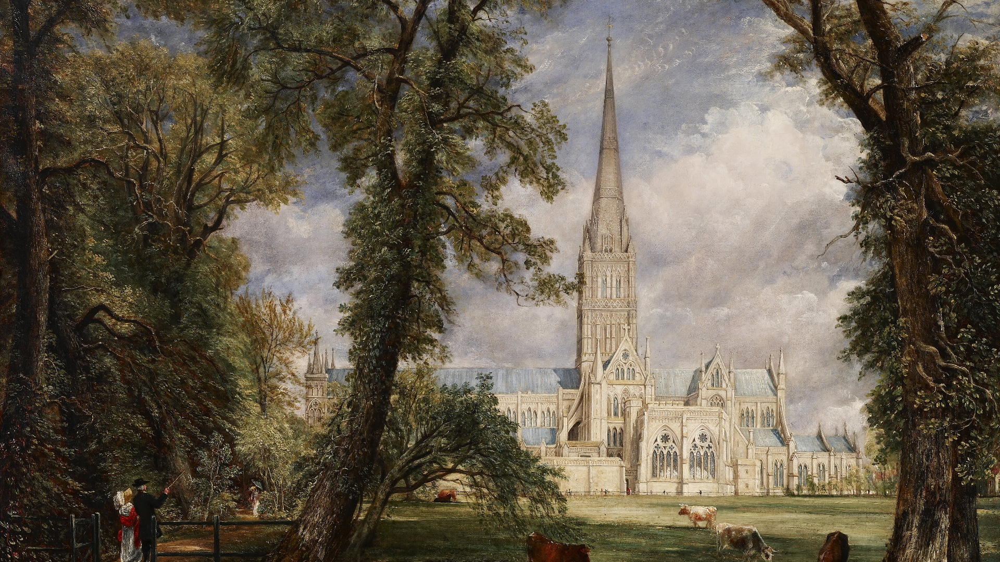
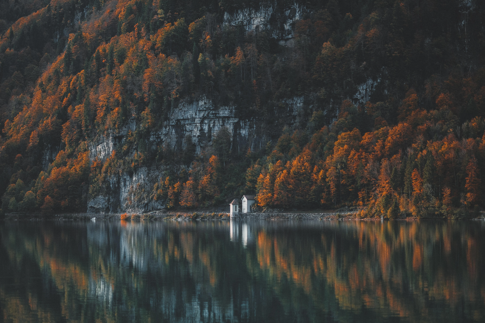
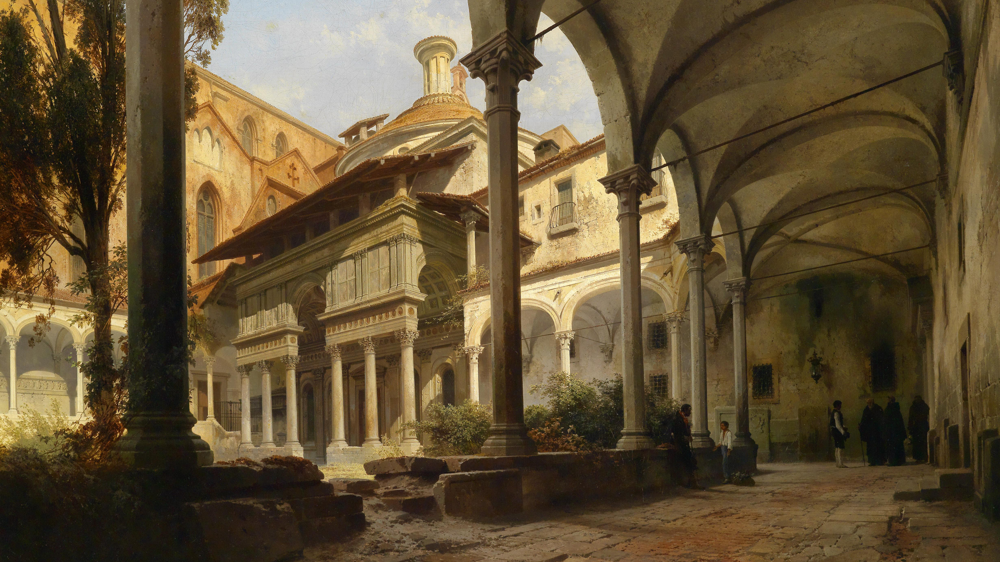
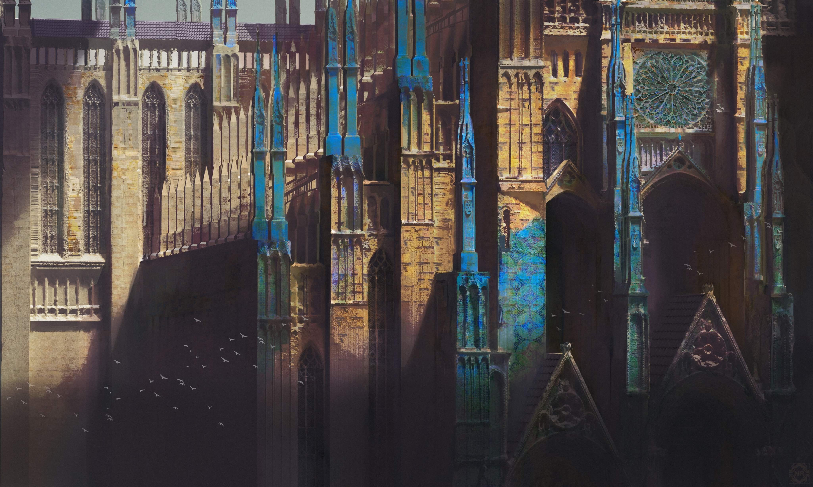
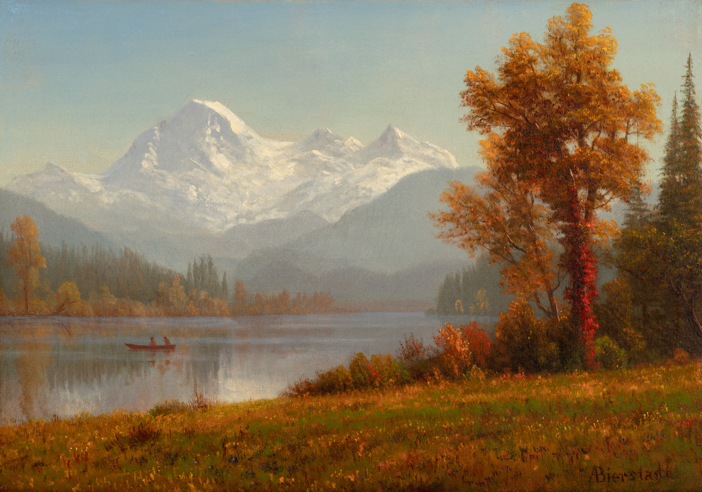
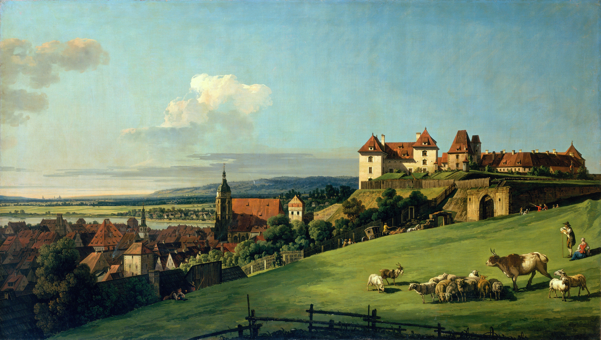
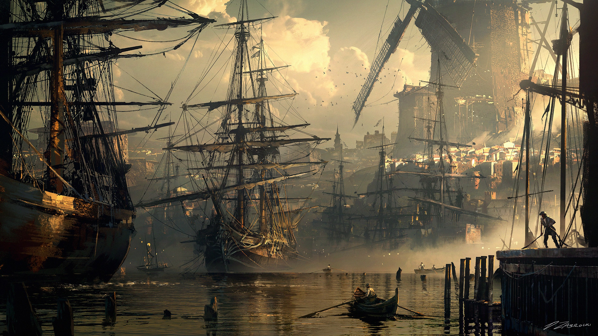
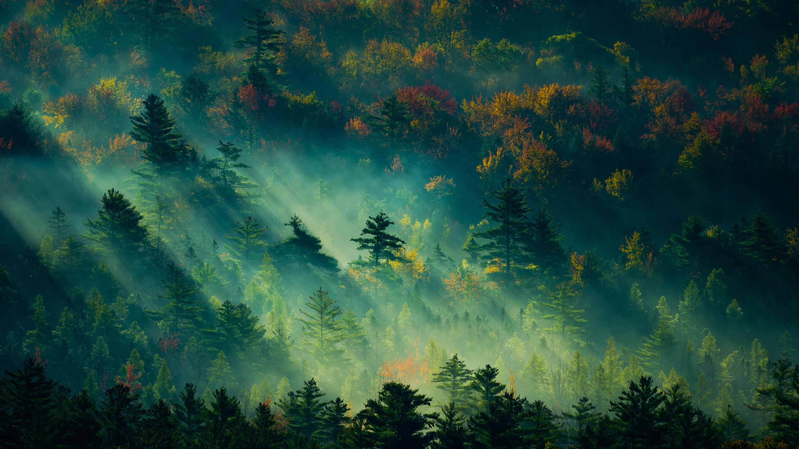
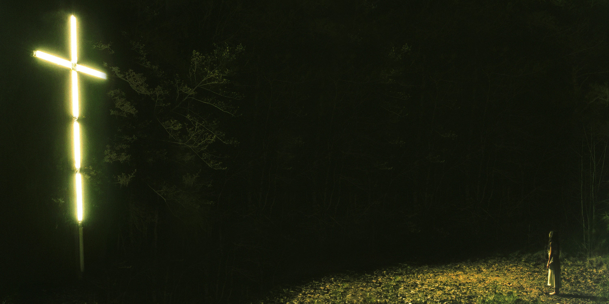

# dotfiles

Personal dotfiles repository managed via GNU Stow for Linux workstations

The primary daily driver environment utilizes the **Niri** scrollable-tiling Wayland compositor paired with the **Noctalia** desktop shell and the **Fish** interactive shell. Legacy configurations for **Hyprland** and **DankMaterialShell (DMS)** remain retained in-tree for compatibility and reference purposes for idk how long.

It also includes my wallpapers ([check them out](#wallpapers))

## Tech Stack & Architecture

### Core Daily Driver

- **Compositor**: [Niri](https://github.com/YaLTeR/niri) (dynamic scrollable-tiling Wayland compositor)
- **Desktop Shell & System UI**: [Noctalia](https://github.com/noctalia-dev/noctalia) (panels, app launcher, clipboard manager, control center, dynamic theme coordinator, and wallpaper daemon)
- **Interactive Shell**: [Fish Shell](https://fishshell.com/)
- **Terminal Emulator**: [Alacritty](https://alacritty.org/)
- **FastFetch**: (very important)

### Package Status & Deprecation Roadmap

| Package Directory | Lifecycle State | Target Description |
| :--- | :--- | :--- |
| `niri` | **Active** | Primary scrollable Wayland compositor config and keybindings |
| `noctalia` | **Active** | Primary desktop UI shell, launcher, and wallpaper management |
| `fish` | **Active** | Interactive shell configuration, custom functions, and abbreviations |
| `alacritty` | **Active** | Primary GPU-accelerated terminal configuration |
| `zed`, `nvim` | **Active** | Editor settings and preferences |
| `wireplumber` | **Active** | PipeWire audio endpoints and channel configuration |
| `wallpapers` | **Active** | Curated high-resolution wallpapers deployed to `~/Pictures/wallpapers` |
| `fastfetch`, `btop` | **Active** | System telemetry and hardware monitoring configurations |
| `hypr` | **Legacy** | Hyprland compositor configurations, scripts, and monitor profiles |
| `dms` | **Legacy** | DankMaterialShell plugins, hooks, and themes |
| `i3`, `waybar` | **Legacy** | Historical X11 and Wayland status bar configurations |

> **Legacy Notice**: Hyprland (`hypr`) and DankMaterialShell (`dms`) configurations are actively preserved alongside the current stack to allow fallback testing and configuration reference. No deprecation or removal date has been set.

## Getting Started

### Prerequisites

Ensure the required core packages and runtimes are present on the host system:

- CachyOS / Arch Linux base installation
- GNU Stow (`pacman -S stow`)
- Niri, Noctalia, and Fish
- Alacritty, Starship, Zoxide, FNM, Atuin, Eza
- PipeWire and WirePlumber

### Installation & Deployment

Each configuration module is organized as a GNU Stow package targeting `$HOME`.

1. Clone repository to the standard dotfiles directory:
   ```bash
   git clone https://github.com/dotsem/dotfiles.git ~/.dotfiles
   cd ~/.dotfiles
   ```

2. Symlink the active daily driver environment:
   ```bash
   # Core shell and window management
   stow niri noctalia fish alacritty

   # System tools, audio, and themes
   stow wireplumber fastfetch btop gtk fontconfig

   # Curated wallpaper library
   stow wallpapers
   ```

To unlink any package at any point:
```bash
stow -D <package_name>
```

## Wallpapers

Things I collected across the years. Shout-out to discord & [wallhaven](https://wallhaven.cc/)

| Preview | Metadata & Description |
| :--- | :--- |
|  | **Salisbury Cathedral from the Bishop's Grounds**<br>**Artist**: John Constable<br>**Resolution**: 1920x1080 |
|  | **Autumn Lake & Mountain Cliff**<br>**Theme**: Alpine lake reflection (Ayu dark palette)<br>**Resolution**: 5967x3978 (Ultra HD) |
|  | **Renaissance Cloister Courtyard**<br>**Style**: Classical architectural courtyard oil painting<br>**Resolution**: 4921x2768 (5K) |
|  | **Gothic Cathedral Facade**<br>**Style**: Atmospheric Gothic cathedral architecture<br>**Resolution**: 3840x2304 (4K) |
|  | **Mount Baker, Washington**<br>**Artist**: Albert Bierstadt<br>**Resolution**: 2052x1440 |
|  | **The Fortress of Sonnenstein above Pirna**<br>**Artist**: Bernardo Bellotto<br>**Resolution**: 4421x2500 (4K) |
|  | **Historic Harbor with Galleons**<br>**Artist**: Darek Zabrocki<br>**Resolution**: 2560x1440 (QHD) |
|  | **Sunlight Through Misty Autumn Forest**<br>**Style**: Autumn tree canopy with morning light rays<br>**Resolution**: 3840x2160 (4K UHD) |
|  | **Knocked Loose - Neon Cross**<br>**Album**: *You Won't Go Before You're Supposed To*<br>**Resolution**: 3000x1500<br> |
